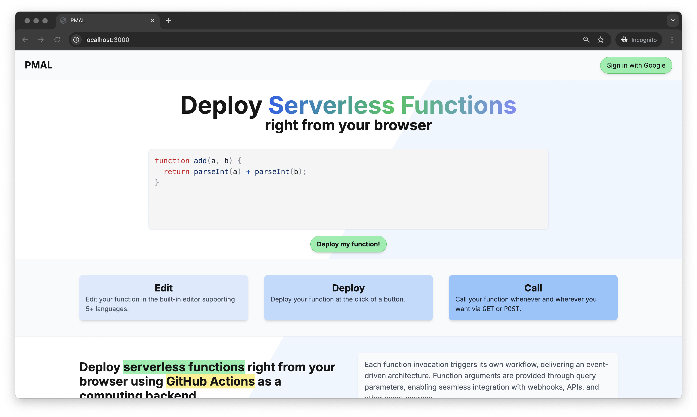

## GitHub Actions Lambda

> Deploy serverless functions directly from your browser using GitHub Actions as a computing backend. Built with Next.js and Supabase.

Each function call triggers a GitHub Actions workflow, using its containerized environment as compute.

[Demo](https://pmal.vercel.app/)
